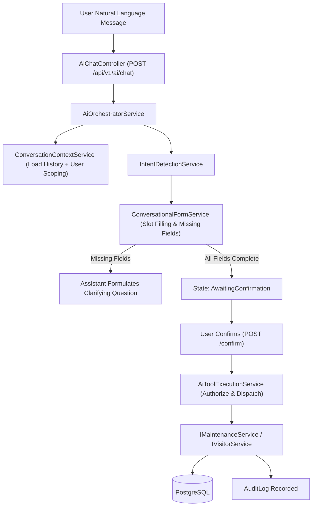

# SmartProperty AI - AI Assistant Architecture & Orchestration

## Core Principles
1. **Never Trust AI Output Directly**: The model produces candidate intent and structured slot arguments; the backend performs schema validation, business logic enforcement, and authorization checks.
2. **Identity from Authentication Context Only**: The model must never decide the user ID, apartment ID, or role. These are injected from the validated ASP.NET Core JWT token.
3. **No Direct SQL or System Access**: The model cannot execute database queries directly; it interacts solely via strongly-typed backend tools.
4. **Two-Phase Confirmation**: High-impact or destructive actions (creating a ticket, approving a visitor, assigning staff) transition to `AwaitingConfirmation` and require explicit user approval.

## AI Component Pipeline

## Tool Registry Matrix by Role

| Tool Name | Parameters | Allowed Roles | Backend Service Invoked |
|---|---|---|---|
| `create_maintenance_request` | title, description, category, priority | Resident | `IMaintenanceService.CreateRequestAsync` |
| `get_my_maintenance_requests` | status (optional) | Resident | `IMaintenanceService.GetResidentRequestsAsync` |
| `get_my_maintenance_request_details` | requestId | Resident | `IMaintenanceService.GetRequestDetailsAsync` |
| `create_visitor_request` | visitorName, purpose, expectedArrival | Resident | `IVisitorService.CreateVisitorAsync` |
| `get_my_visitor_requests` | none | Resident | `IVisitorService.GetResidentVisitorsAsync` |
| `get_my_apartment_details` | none | Resident | `IApartmentService.GetByResidentAsync` |
| `get_assigned_maintenance_requests` | status (optional) | Staff | `IMaintenanceService.GetAssignedRequestsAsync` |
| `update_maintenance_status` | requestId, status, comment | Staff | `IMaintenanceService.UpdateStatusAsync` |
| `add_maintenance_note` | requestId, noteText, isInternalOnly | Staff | `IMaintenanceService.AddNoteAsync` |
| `register_visitor` | visitorName, apartmentNumber, purpose | Staff | `IVisitorService.RegisterWalkInVisitorAsync` |
| `check_in_visitor` | visitorId | Staff | `IVisitorService.CheckInVisitorAsync` |
| `check_out_visitor` | visitorId | Staff | `IVisitorService.CheckOutVisitorAsync` |
| `get_all_maintenance_requests` | status, category, propertyId | Administrator | `IMaintenanceService.GetAllRequestsAsync` |
| `assign_maintenance_request` | requestId, staffId | Administrator | `IMaintenanceService.AssignStaffAsync` |
| `update_maintenance_request` | requestId, priority, title | Administrator | `IMaintenanceService.UpdateRequestAsync` |
| `get_property_statistics` | propertyId | Administrator | `IAnalyticsService.GetPropertyStatsAsync` |
| `get_resident_information` | residentId / apartmentNumber | Administrator | `IResidentService.GetResidentAsync` |
| `get_visitor_records` | propertyId, date | Administrator | `IVisitorService.GetAllVisitorsAsync` |
| `approve_visitor_request` | visitorId | Administrator | `IVisitorService.ApproveVisitorAsync` |

