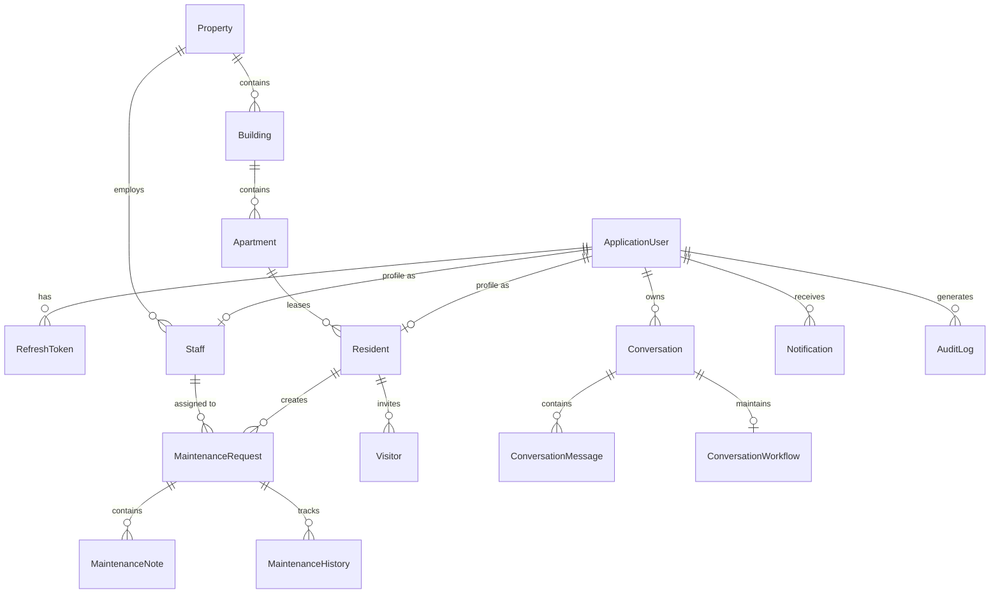

# SmartProperty AI - Database Design

## Database Engine
- **Engine**: PostgreSQL 16/17
- **ORM**: Entity Framework Core with Npgsql Provider
- **Convention**: Snake_case table and column names, UTC timestamps, GUID primary keys.

## Entity-Relationship Diagram (Conceptual)

## Core Tables & Schema Specifications

1. **AspNetUsers** & **AspNetRoles**: Standard ASP.NET Core Identity with additional columns (`full_name`, `is_active`, `created_at`, `updated_at`).
2. **refresh_tokens**: `id` (UUID), `user_id` (FK), `token_hash` (VARCHAR), `jwt_id` (VARCHAR), `expires_at_utc`, `created_at_utc`, `revoked_at_utc`, `replaced_by_token_hash`.
3. **properties**: `id` (UUID), `name`, `description`, `address`, `city`, `country`, `property_type`, `created_at`, `updated_at`, `is_deleted`.
4. **buildings**: `id` (UUID), `property_id` (FK), `name`, `floor_count`, `description`, `is_deleted`.
5. **apartments**: `id` (UUID), `building_id` (FK), `apartment_number`, `floor`, `number_of_bedrooms`, `number_of_bathrooms`, `occupancy_status`, `is_deleted`.
6. **residents**: `id` (UUID), `user_id` (FK), `apartment_id` (FK), `full_name`, `phone_number`, `email`, `emergency_contact`, `move_in_date`, `move_out_date`, `status`, `is_deleted`.
7. **staff**: `id` (UUID), `user_id` (FK), `property_id` (FK), `employee_number`, `position`, `employment_status`, `is_deleted`.
8. **maintenance_requests**: `id` (UUID), `resident_id` (FK), `apartment_id` (FK), `title`, `description`, `category`, `priority`, `status`, `assigned_staff_id` (FK nullable), `image_url`, `created_at`, `updated_at`, `resolved_at`, `is_deleted`.
9. **maintenance_notes**: `id` (UUID), `maintenance_request_id` (FK), `author_user_id` (FK), `note_text`, `is_internal_only`, `created_at`.
10. **maintenance_histories**: `id` (UUID), `maintenance_request_id` (FK), `changed_by_user_id` (FK), `previous_status`, `new_status`, `change_reason`, `timestamp`.
11. **visitors**: `id` (UUID), `resident_id` (FK), `visitor_name`, `visitor_phone`, `purpose`, `expected_arrival`, `expected_departure`, `status`, `approved_by` (FK nullable), `checked_in_at`, `checked_out_at`, `created_at`, `is_deleted`.
12. **conversations**: `id` (UUID), `user_id` (FK), `role`, `title`, `status`, `created_at`, `updated_at`, `is_deleted`.
13. **conversation_messages**: `id` (UUID), `conversation_id` (FK), `sender_type`, `content`, `metadata_json`, `created_at`.
14. **conversation_workflows**: `id` (UUID), `conversation_id` (FK unique), `intent`, `workflow_type`, `collected_fields_json`, `missing_fields_json`, `pending_action_json`, `confirmation_status`, `updated_at`.
15. **notifications**: `id` (UUID), `user_id` (FK), `title`, `message`, `notification_type`, `is_read`, `read_at`, `created_at`.
16. **audit_logs**: `id` (UUID), `user_id` (FK nullable), `action`, `entity_type`, `entity_id`, `previous_values`, `new_values`, `ip_address`, `timestamp`.

